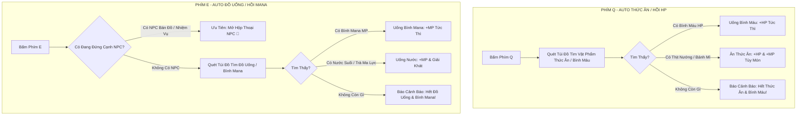

# BIÊN BẢN THẢO LUẬN & ĐẶC TẢ HỆ THỐNG SỐ 05
# HỆ THỐNG THỨC ĂN, ĐỒ UỐNG, DƯỢC PHẨM & CƠ CHẾ TIÊU THỤ TỰ ĐỘNG THÔNG MINH (Q & E AUTO-CONSUME SYSTEM)

**Mã tài liệu:** `discussion_05_food_drink_potions_and_consumables_system.md`  
**Ngày ghi nhận:** 11/10/2026 (05:15 AM)  
**Chủ tọa / Game Director:** SquiRRels Studio  
**Trạng thái phiên họp:** Đã thống nhất & Triển khai toàn diện vào mã nguồn (Fully Implemented)  

---

## 1. MỤC TIÊU CUỘC THẢO LUẬN & ĐẶT VẤN ĐỀ

Trong các buổi thảo luận về cơ chế sinh tồn và trải nghiệm người dùng (UX) của *Godless Fantasy*, Game Director (SquiRRels Studio) đã đưa ra chỉ thị cốt lõi:

> *"Có thể cho pet lên level => pet có thể tiến hóa theo level => to hơn hình dạng đẹp hơn kiểu kiểu vậy nhé, cho pet ăn được đồ ăn, ... đồ ăn dành cho pet, mình cũng ăn được đồ ăn. Nước thì hồi mana, thức ăn thì hồi hp và mana tùy.  
> Tóm lại Q E => sẽ auto ăn tất cả không phân biệt thuốc hay đồ ăn, chỉ phân biệt ở chỗ nó là nước hay thức ăn.  
> Đồ uống / thức ăn hoặc (potion hp / potion mana) ghi chép tất cả vào discussions khác."*

### Bối Cảnh Sinh Tồn Trong Godless Fantasy
1. **Sự phối hợp với Cơ chế Hồi Máu Khắc Khổ (Harsh HP Regeneration):**  
   - Nhân vật tự nhiên phải mất **30 giây – 40 giây mới hồi được +1 đến +2 HP**. Do đó, sinh mạng nhân vật là tài nguyên cực kỳ đắt giá.
   - Thức ăn, nước uống và các bình dược liệu là phương tiện sinh tồn chính yếu của người chơi khi đi thám hiểm rừng rậm, vượt ngục tối (Dungeon) hay giao tranh PvP khốc liệt.
2. **Loại bỏ sự phiền phức khi gán phím (Frictionless UX):**  
   - Trong các game MMORPG cổ điển, người chơi thường phải kéo từng bình máu hoặc từng miếng thịt vào ô hotbar riêng biệt, gây chật chội và rối mắt.
   - *Godless Fantasy* giải quyết triệt để vấn đề này bằng cơ chế **Phím Tắt Đa Năng Thông Minh (Universal Smart Quick-slot [Q] & [E])**: Người chơi chỉ cần ấn một nút duy nhất, hệ thống tự động tìm và tiêu thụ món hồi phục tối ưu nhất trong túi đồ.

---

## 2. NGUYÊN TẮC VÀNG: PHÂN BIỆT BẢN CHẤT "THỨC ĂN" VS "NƯỚC UỐNG"

### 2.1. Quy Luật Hoạt Động Của Phím [Q] & [E]



#### 🍖 Phím [Q]: AUTO THỨC ĂN (Food / HP Recovery)
* **Triết lý:** Không phân biệt đó là Dược Phẩm (Bình Máu) hay Thực Phẩm (Thịt Nướng, Bánh Mì, Súp Rau Củ).  
* **Quy chuẩn:** Bất kỳ món nào mang bản chất **Thức Ăn / Hồi Phục Sinh Lực** sẽ được tự động kích hoạt khi bấm [Q].
* **Thứ tự ưu tiên quét trong hành trang:**
  1. Ưu tiên 1: Bình Máu HP (Hồi máu khẩn cấp tức thì).
  2. Ưu tiên 2: Thức Ăn cao cấp (Thịt Nướng Lửa Hồng: +50 HP & +20 MP).
  3. Ưu tiên 3: Lương khô / Bánh mì cơ bản (+25 HP).

#### 💧 Phím [E]: AUTO ĐỒ UỐNG (Drink / Mana Recovery)
* **Triết lý:** Không phân biệt đó là Dược Phẩm (Bình Mana) hay Nước Giải Khát (Nước Suối Thanh Khiết, Trà Ma Lực).
* **Quy chuẩn:** Bất kỳ món nào mang bản chất **Nước Uống / Hồi Phục Ma Pháp & Tinh Thần** sẽ được tự động kích hoạt khi bấm [E].
* **Thứ tự ưu tiên quét trong hành trang:**
  1. Ưu tiên 1: Bình Mana MP (Hồi mana khẩn cấp tức thì để kịp tung chiêu / lướt né đòn).
  2. Ưu tiên 2: Nước Suối Thanh Khiết / Trà Ma Lực (+40 MP).
* **Cơ chế phân tách ngữ cảnh với NPC:**
  - Nếu người chơi đang đứng trong phạm vi tương tác của NPC ($Distance \le 2.5m$), phím [E] sẽ kích hoạt **Nói Chuyện với NPC**.
  - Nếu người chơi không đứng cạnh NPC hoặc đang trong chiến đấu, phím [E] sẽ kích hoạt **Tự Động Uống Nước / Dùng Mana**.

---

## 3. PHÂN LOẠI CHI TIẾT 4 NHÓM TIÊU HAO TRONG GAME

Trong hệ thống dữ liệu của *Godless Fantasy*, các vật phẩm tiêu hao (`ItemType.Consumable`) được phân cấp thành 4 nhóm chức năng tách bạch:

### 3.1. Nhóm Dược Phẩm (Potions - Thuốc Cứu Nguy)
* **Đặc tính:** Dung dịch cô đặc ma thuật, thẩm thấu ngay lập tức.
* **Thời gian tác dụng:** **Tức thì (Instant)**.
* **Mục đích sử dụng:** Dành cho các tình huống ngặt nghèo giữa giao tranh Boss hoặc đấu trường sinh tử PvP khi sắp cạn máu hoặc cạn mana không thể dùng Dash.

### 3.2. Nhóm Thức Ăn Nhân Vật (Food - Sinh Lực & No Nê)
* **Đặc tính:** Các món ăn được chế biến từ săn bắn, nấu nướng hoặc mua tại Quán Trọ / NPC Đầu Bếp.
* **Thời gian tác dụng:** Hồi phục một phần tức thì và duy trì hiệu ứng dễ chịu (hồi phục sinh lực lẫn ma lực).
* **Quy ước:** Chỉ **Nhân Vật** mới ăn được thức ăn này, thú cưng KHÔNG ăn được.

### 3.3. Nhóm Đồ Uống Nhân Vật (Drinks - Ma Lực & Thanh Lọc)
* **Đặc tính:** Nước suối nguồn tinh khiết, rượu vang tiên tộc, trà thảo mộc.
* **Thời gian tác dụng:** Bổ sung năng lượng ma pháp dồi dào, giải trừ trạng thái khô hạn tinh thần.
* **Quy ước:** Dành riêng cho người chơi uống để hồi Mana.

### 3.4. Nhóm Thức Ăn Thú Cưng (Pet Food - Linh Khí Nuôi Dưỡng)
* **Đặc tính:** Thảo dược, hạt dẻ, tinh hoa linh thú kết tinh từ tự nhiên.
* **Quy ước tối thượng:** **Nhân vật KHÔNG THỂ ăn món này**.
* **Công dụng:** Cho Thú Cưng ăn trực tiếp trong Tab 4 hoặc Inspector Túi Đồ để cộng **EXP Thú Cưng**, giúp Thú Cưng thăng cấp và **tiến hóa to hơn, đẹp hơn** theo 3 giai đoạn.

---

## 4. BẢNG DANH MỤC VẬT PHẨM TIÊU HAO CHI TIẾT (ITEM DATABASE)

| Mã ID Vật Phẩm | Tên Vật Phẩm | Phẩm Cấp | Nhóm Phân Loại | Biểu Tượng Icon | Hiệu Quả Chỉ Số Hồi Phục | Phím Tắt Tự Động |
| :--- | :--- | :---: | :--- | :---: | :--- | :---: |
| `item_hp_pot` | **Bình Máu HP Nhỏ** | Phẩm E (Trắng) | Dược Phẩm | `item_potion_hp` | • Hồi **+35 HP** tức thì | **[Q]** |
| `item_mp_pot` | **Bình Mana Nhỏ** | Phẩm E (Trắng) | Dược Phẩm | `item_potion_mana` | • Hồi **+30 Mana** tức thì | **[E]** |
| `item_hp_pot_large`| **Bình Đại Dược Sinh Mệnh** | Phẩm C (Lam) | Dược Phẩm | `item_potion_hp` | • Hồi **+120 HP** tức thì | **[Q]** |
| `item_mp_pot_large`| **Bình Đại Dược Ma Linh** | Phẩm C (Lam) | Dược Phẩm | `item_potion_mana` | • Hồi **+100 Mana** tức thì | **[E]** |
| `item_roast_meat`| **Thịt Nướng Lửa Hồng** | Phẩm D (Xanh Lá)| Thức Ăn | `item_potion_hp` | • Hồi **+30 HP** & **+20 MP** | **[Q]** |
| `item_bread` | **Bánh Mì Lúa Mạch** | Phẩm E (Trắng) | Thức Ăn | `item_potion_hp` | • Hồi **+25 HP** | **[Q]** |
| `item_water` | **Nước Suối Thanh Khiết** | Phẩm D (Xanh Lá)| Đồ Uống | `item_potion_mana` | • Hồi **+35 Mana** | **[E]** |
| `item_arcane_tea`| **Trà Ma Lực Hoa Tuyết** | Phẩm C (Lam) | Đồ Uống | `item_potion_mana` | • Hồi **+60 Mana** & +1 MP/s (30s) | **[E]** |
| `item_pet_food` | **Hạt Dẻ Linh Hồn** | Phẩm C (Vàng) | Thức Ăn Pet | `item_potion_hp` | • **+60 EXP Thú Cưng** (Tăng cấp & tiến hóa) | *Dùng trong Tab Pet / Túi Đồ* |

---

## 5. CƠ CHẾ PHẢN HỒI HÌNH ẢNH & ÂM THANH (UX / FEEDBACK)

Để tạo cảm giác thỏa mãn tối đa khi người chơi tiêu thụ đồ ăn thức uống:
1. **Chữ Số Nảy Lên (Floating Text Feedback):**
   - Hồi máu: Bay lên dòng chữ xanh ngọc sáng `+35 HP` (hoặc `+30 HP`).
   - Hồi mana: Bay lên dòng chữ xanh dương huyền ảo `+30 MP` (hoặc `+35 MP`).
   - Cho thú cưng ăn: Bay lên dòng chữ màu hồng/vàng `💖 +60 EXP (Pet)` và khi lên cấp: `🎉 PET LÊN CẤP X!`.
2. **Cảnh Báo Hết Tài Nguyên (Resource Depletion Toast):**
   - Khi bấm phím [Q] mà trong túi không còn bất kỳ bình máu hay thức ăn nào: Hiển thị cảnh báo màu đỏ trên màn hình: `⚠️ Hết thức ăn và bình hồi phục HP trong túi!`.
   - Khi bấm phím [E] mà trong túi không còn bất kỳ bình mana hay nước uống nào: Hiển thị cảnh báo màu xanh lơ: `⚠️ Hết đồ uống và bình hồi phục Mana trong túi!`.
3. **Thời Gian Hồi Phục Nhẹ Giữa 2 Lần Dùng (Internal Cooldown - 1.0s):**
   - Để ngăn người chơi vô tình bấm đúp làm phí phạm bình thuốc quý, mỗi thao tác ăn/uống có giãn cách tối thiểu 1.0 giây.

---

## 6. KIẾN TRÚC MÃ NGUỒN ĐÃ TRIỂN KHAI

### 6.1. Phương Thức Xử Lý Trong `PlayerStats.cs`
```csharp
/// <summary>
/// PHÍM [Q]: Tự Động Ăn Thức Ăn Hoặc Dùng Bình Máu HP (Không phân biệt thuốc hay thức ăn).
/// </summary>
public void UseFoodOrHpRecovery()
{
    var inv = GetComponent<InventoryManager>();
    if (inv == null) return;

    if (inv.ConsumeItem("item_hp_pot", 1))
    {
        HealHp(35);
        FloatingDamageManager.SpawnHeal(transform.position, 35, false);
    }
    else if (inv.ConsumeItem("item_roast_meat", 1))
    {
        HealHp(30);
        RestoreMana(20);
        FloatingDamageManager.SpawnHeal(transform.position, 30, false);
        FloatingDamageManager.SpawnHeal(transform.position + Vector3.up * 0.4f, 20, true);
    }
    else
    {
        Debug.LogWarning("[SINH TỒN] Túi đồ không còn Thức Ăn hoặc Bình Máu nào!");
    }
}

/// <summary>
/// PHÍM [E]: Tự Động Uống Nước Hoặc Dùng Bình Mana MP (Không phân biệt thuốc hay nước uống).
/// </summary>
public void UseDrinkOrManaRecovery()
{
    var inv = GetComponent<InventoryManager>();
    if (inv == null) return;

    if (inv.ConsumeItem("item_mp_pot", 1))
    {
        RestoreMana(30);
        FloatingDamageManager.SpawnHeal(transform.position, 30, true);
    }
    else if (inv.ConsumeItem("item_water", 1))
    {
        RestoreMana(35);
        FloatingDamageManager.SpawnHeal(transform.position, 35, true);
    }
    else
    {
        Debug.LogWarning("[SINH TỒN] Túi đồ không còn Đồ Uống hoặc Bình Mana nào!");
    }
}
```

### 6.2. Nút Thao Tác Trực Tiếp Trong Bảng Chi Tiết Vật Phẩm (`CombatHUD.cs`)
Trong Inspector của Tab 2 [Túi Đồ], khi người chơi click chọn từng món tiêu hao:
- Chọn Hạt Dẻ Linh Hồn $\rightarrow$ Xuất hiện nút vàng hoàng kim: `[CHO THÚ ĂN (+60 EXP)]`.
- Chọn Thịt Nướng Lửa Hồng $\rightarrow$ Xuất hiện nút cam: `[ĂN THỊT (+50 HP / +20 MP)]`.
- Chọn Nước Suối Thanh Khiết $\rightarrow$ Xuất hiện nút lam sáng: `[UỐNG NƯỚC (+40 MP)]`.
- Chọn Bình Máu / Bình Mana $\rightarrow$ Xuất hiện nút: `[UỐNG BÌNH MÁU]` / `[UỐNG BÌNH MANA]`.

---

## 7. KẾT LUẬN & ĐỊNH HƯỚNG MỞ RỘNG
Hệ thống Thức Ăn, Đồ Uống và Dược Phẩm được cấu trúc riêng biệt trong tài liệu này đảm bảo:
1. Độc lập, rõ ràng, không bị chồng chéo với hệ thống Kỹ Năng / Chức Nghiệp.
2. Thiết lập quy chuẩn vững chắc cho hệ thống Nấu Nướng (Cooking Crafting System), Hái Lượm (Gathering) và Buôn Bán Quán Trọ (Tavern NPC Trade) trong các bản cập nhật tiếp theo của dự án.

---
**Ký duyệt:** SquiRRels Studio  
*Godless Fantasy — Thế Giới Nhập Vai MMORPG Khắc Nghiệt & Chân Thật.*
