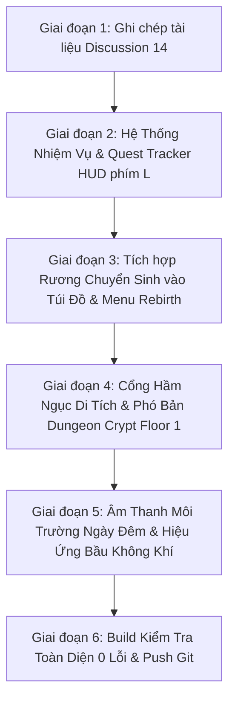

# THẢO LUẬN & ĐẶC TẢ KỸ THUẬT: BẢN ĐỒ THẾ GIỚI 270M, CHU KỲ NGÀY ĐÊM, HỆ THỐNG NHIỆM VỤ & PHÓ BẢN HẦM NGỤC

**Mã tài liệu:** `DOC-DISC-14-WORLD-DAYNIGHT-QUEST-DUNGEON`  
**Dự án:** Godless Fantasy (2D Topdown MMORPG Alpha Slice)  
**Ngày lập:** 12/10/2026  
**Trạng thái:** Đang triển khai tuần tự toàn diện (In Progress)  

---

## 1. TỔNG QUAN TIẾN ĐỘ & TRẠNG THÁI HIỆN TẠI

| Hạng mục | Trạng thái | Chi tiết kỹ thuật |
|---|:---:|---|
| **Bản đồ mở rộng x3 (270m x 132m)** | ✅ Hoàn thành | Kiến trúc Chunk Streaming 16x16 tiles/chunk, nạp 5x5 chunks quanh Camera, 120 FPS không giật lag. |
| **Chu kỳ Ngày & Đêm (Day-Night Engine)** | ✅ Hoàn thành | 24h thế giới chia 4 pha (Bình Minh, Ngày, Hoàng Hôn, Đêm Trăng), Full-screen Camera Tint Overlay, Đom đóm dạ quang, Đuốc bùng sáng. |
| **Label Giờ Thế Giới** | ✅ Hoàn thành | Nằm ngay dưới Minimap mép phải, hiển thị icon động + giờ thế giới + canh giờ (`☀️ 12:30 · Ban Ngày` / `🌙 22:15 · Đêm Trăng`). |
| **Màn Hình Tử Trận & Rơi Đồ 50%** | ✅ Hoàn thành | Màn hình tối sầm (Blackout), bảo vệ vĩnh viễn 5 ô, 50% đồ còn lại rơi văng tự do ra sàn đất, nút Hồi Sinh về Làng Tân Thủ. |
| **Rương Chuyển Sinh (Rebirth Vault)** | ✅ Hoàn thành | Quản lý lưu trữ vĩnh viễn 2 món bảo vật Server qua file JSON `rebirth_vault.json`, cho phép cất/rút tại Đền Chuyển Sinh. |
| **Dàn NPC Làng Tân Thủ** | ✅ Hoàn thành | Trưởng Làng Eldrin, Thương Nhân Barnaby (Shop/Bán rác), Thợ Rèn Vulkan (+1..+10), Phù Thủy Morgana (Buff), Sứ Giả Kaelen (RP Shop). |
| **Hệ thống Nhiệm Vụ & Quest Tracker [L]** | 🔄 Đang triển khai | Widget theo dõi nhiệm vụ góc phải dưới Minimap, Sổ tay nhiệm vụ phím [L], chuỗi 4 nhiệm vụ cốt truyện tân thủ. |
| **Phó Bản Hầm Ngục Di Tích (Dungeon Crypt)** | ⏳ Kế tiếp | Đi qua Cổng Hầm Ngục tại (120, 25) để tiến vào tầng 1 phó bản hắc ám với quái và rương Boss. |
| **Âm thanh Môi trường Ngày/Đêm** | ⏳ Kế tiếp | Tiếng chim hót ban ngày, dế kêu rả rích ban đêm, tiếng chuông giao canh. |

---

## 2. QUY TRÌNH THỰC HIỆN TUẦN TỰ TOÀN BỘ CÁC VẤN ĐỀ

---

## 3. THIẾT KẾ CHI TIẾT CÁC TÍNH NĂNG ĐANG TRIỂN KHAI

### 3.1. Hệ Thống Nhiệm Vụ Tân Thủ (Quest Engine & QuestTrackerHUD)
1. **Dữ Liệu Nhiệm Vụ (`QuestDefinition`):**
   - **Q1: [Tân Thủ Khởi Hành]**: Gặp gỡ Trưởng Làng Eldrin tại Quảng Trường `(-72, 2)`. Phần thưởng: 50 Vàng, 100 EXP.
   - **Q2: [Rèn Luyện Cơ Bản]**: Tấn công Bù Nhìn Gỗ tại Bãi Võ `(-76, -12)` 5 lần bằng đòn đánh hoặc kỹ năng. Phần thưởng: 100 Vàng, 200 EXP, 3 Bình Máu HP.
   - **Q3: [Bảo Vệ Biên Giới]**: Tiến ra bìa rừng tiêu diệt 2 Chiến Binh Quái `(18, 4)`. Phần thưởng: 200 Vàng, 400 EXP, 1 Cuộn Chiêu Sơ Cấp.
   - **Q4: [Thám Hiểm Cổ Tích]**: Thám hiểm Cổng Hầm Ngục Di Tích tại `(120, 25)`. Phần thưởng: 500 Vàng, 1000 EXP, 1 Điểm Chuyển Sinh (RP).
2. **Giao Diện Hiển Thị:**
   - **Widget Quest Tracker**: Thu gọn dưới Giờ Thế Giới mép phải, hiển thị tên nhiệm vụ hiện tại, mục tiêu (ví dụ: `Đánh Bù Nhìn: 3/5`) và phím tắt `[L] Sổ Tay`.
   - **Sổ Tay Nhiệm Vụ (Phím L)**: Modal phong cách Fantasy cổ điển, xem danh sách nhiệm vụ đã nhận, nhiệm vụ hoàn thành, mô tả cốt truyện và phần thưởng.

### 3.2. Tích Hợp Rương Chuyển Sinh (Rebirth Vault Integration)
- Khi mở Túi Đồ (Phím B) đứng gần Đền Chuyển Sinh hoặc khi bấm chuột phải vào vật phẩm: Có nút `[Cất vào Rương Chuyển Sinh (2/2)]`.
- Trong Menu Chuyển Sinh (Tab Rebirth): Bổ sung nút cảnh báo kiểm tra Rương Chuyển Sinh trước khi bấm Rebirth về Lv 1.

### 3.3. Cổng Phó Bản Hầm Ngục Di Tích (Dungeon Crypt Floor 1)
- Vị trí: `(120, 25)` - Cổng Vòm Cự Thạch (`prop_dungeon_gate`).
- Khi người chơi chạy vào phạm vi cổng: Hiện thông báo `[E] Bước vào Phó Bản Hầm Ngục Di Tích`.
- Phó Bản Floor 1: Phòng đá ngầm âm u, đèn đuốc bốc lửa xanh lục, bãi quái Thây Ma Chiến Binh và Rương Kho Báu Di Tích.
