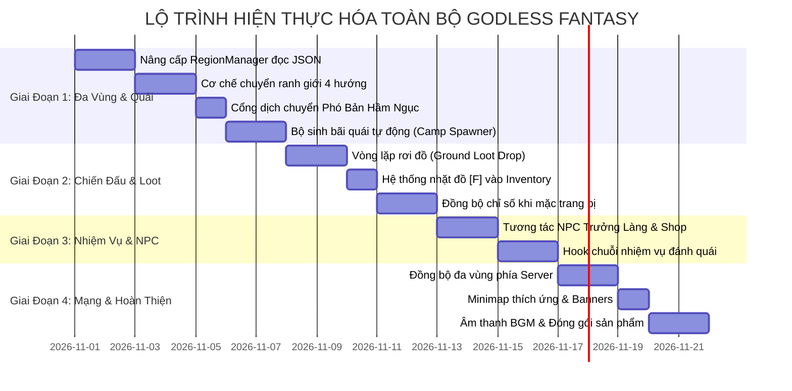

# ⚔️ BẢN ĐỒ CHIẾN LƯỢC TOÀN DIỆN HIỆN THỰC HÓA GODLESS FANTASY
### *Master Gap Analysis & Production Realization Roadmap (V2.0)*

---

## 🧭 I. TỔNG QUAN TẦM NHÌN & TRIẾT LÝ PHÁT TRIỂN

Dự án **Godless Fantasy** đã hoàn thành xuất sắc những nền móng cốt lõi:
- Đồ họa nhân vật phong cách **Retro Anime Fantasy 16-bit** với áo choàng trùm đầu tuyệt đẹp, hoạt ảnh 8 hướng đi lại mượt mà, chân dung avatar và thẻ toàn thân cao cấp.
- Hệ thống địa hình gộp khối Mesh Combiner và Texture Atlas tối ưu trên **300 - 500+ FPS**.
- Bộ công cụ Web Builder **Godless Map Studio** và **Godless Skill Studio** phục vụ sáng tạo nội dung trực quan.
- Hệ thống chiến đấu cơ bản, khóa mục tiêu (Reticle), tung chiêu, di chuyển chuột, né đòn (Dash), chớp đỏ (Hit Flash) và sát thương số bay (Floating Damage).

Tuy nhiên, giữa các hệ thống hiện tại vẫn còn tồn tại các **Khoảng Trống (Gaps)** ngăn cách thế giới game trở thành một tựa game MMORPG / ARPG hoàn chỉnh khép kín. 

Bản kế hoạch này lập ra để **xác định chính xác từng Gap** và đưa ra **Lộ trình hiện thực hóa 100% mọi tính năng**, chuyển hóa toàn bộ mã tĩnh/tạm thời thành các hệ thống tự động, động hóa và liên kết chặt chẽ với nhau.

---

## 🔍 II. MA TRẬN PHÂN TÍCH KHOẢNG TRỐNG (GAP MATRIX)

| Phân Hệ | Hiện Trạng (Current State) | Mục Tiêu Chuẩn (Target State) | Mức Độ Ưu Tiên |
| :--- | :--- | :--- | :--- |
| **1. Bản Đồ & Phân Vùng** | Map tĩnh bằng mã lệnh C# (`BlockMapManager.cs`), chưa tự động nạp từ JSON, chưa có cơ chế đổi vùng 4 hướng khi chạm mép biên. | Nạp động từ file JSON `region_{id}.json`. Khi chạm mép 4 hướng, vùng cũ lập tức hủy render, vùng mới nạp lên, người chơi xuất hiện ở mép đối diện chuẩn tọa độ. Cổng hầm ngục cô lập độc lập. | **P0 (Cực Cao - Đang làm)** |
| **2. Quái Vật & Bãi Luyện** | Quái vật tạo cứng thủ công trong `DemoBootstrapper.cs`. Bị cố định số lượng và vị trí. | Nạp động từ danh sách `monsterCamps` trong file JSON khu vực. Cơ chế tuần tra, truy đuổi, leashing, rơi đồ (Ground Loot), thưởng Exp/Vàng, và vòng lặp hồi sinh định kỳ. | **P0 (Cực Cao)** |
| **3. Thu Nhặt Rơi Đồ (Loot)** | Mã `GroundLootItem.cs` đã có nhưng chưa được kích hoạt tự động khi quái chết. | Khi quái bị tiêu diệt, rơi ra tiền vàng, bình máu/mana, hoặc trang bị lấp lánh trên mặt đất. Người chơi lại gần bấm phím [F] hoặc tự động hút vào Hành Trang (Inventory). | **P1 (Cao)** |
| **4. Ranh Giới & Minimap** | Bản đồ nhỏ (Minimap) trong `CombatHUD.cs` đang fix cứng dải tọa độ $(-135..135, -66..66)$. | Minimap tự động co giãn theo kích thước của Khu Vực hiện tại (`currentRegion.dimensions`). Hiển thị biểu ngữ chuyển vùng: *"📍 Bạn đã bước vào: [Tên Vùng]"*. | **P1 (Cao)** |
| **5. Cửa Hàng & Trao Đổi NPC** | Modal `VillageShopNPCModal.cs` đã dựng giao diện nhưng chưa liên kết bấm [E] mở thoại với NPC Trưởng Làng / Thợ Rèn. | Tương tác NPC dân làng bằng phím [E] mở cửa hàng mua bán bình dược, cuộn giấy kỹ năng, bán đồ rác lấy Vàng. | **P1 (Cao)** |
| **6. Chuỗi Nhiệm Vụ (Quests)** | `QuestManager.cs` có 4 nhiệm vụ mẫu nhưng chưa hook sự kiện tự động khi đánh quái hoặc nói chuyện NPC. | Đánh đủ số quái trong bãi tự động cập nhật tiến độ `1/5`, `2/5` $\rightarrow$ Hiện thông báo trên Quest Tracker $\rightarrow$ Trả nhiệm vụ nhận thưởng Exp & Vàng. | **P1 (Cao)** |
| **7. Mạng Đa Vùng (Networking)** | Máy chủ `WebSocketServer.cs` coi toàn bộ người chơi ở chung 1 không gian duy nhất. | Quản lý `CurrentRegionId` cho từng người chơi. Chỉ broadcast gói tin di chuyển, chiến đấu và quái vật cho những người ở cùng khu vực. | **P2 (Trung Bình)** |
| **8. Âm Thanh & Bầu Không Khí** | `AudioManager.cs` có nền tảng nhưng thiếu nhạc nền (BGM) riêng cho từng vùng và âm thanh bước chân/đánh trúng. | BGM êm đềm ở Làng Tân Thủ, BGM rùng rợn bí ẩn ở Rừng Rậm & Hầm Ngục. Tiếng chém kiếm, bắn sét, tiếng nhặt vàng kêu leng keng. | **P2 (Trung Bình)** |

---

## 🗺️ III. KẾ HOẠCH TRIỂN KHAI THEO 4 GIAI ĐOẠN (ROADMAP)



---

## 🛠️ IV. THIẾT KẾ CHI TIẾT CÁC PHÂN HỆ CỐT LÕI

### 1. Phân Hệ Bản Đồ & Chuyển Vùng 4 Hướng (`RegionManager.cs`)
- **Tập tin cấu hình**: Đọc trực tiếp các file JSON từ `Assets/Resources/Maps/`:
  - `world_manifest.json`: Danh mục mạng lưới thế giới.
  - `region_village_0_0.json`: Làng Tân Thủ & Đại Lộ Cổ.
  - `region_east_forest_1_0.json`: Rừng Rậm Hắc Ám & Tàn Tích.
  - `dungeon_crypt_floor_1.json`: Hầm Ngục Di Tích Tầng 1.
- **Hàm cốt lõi**:
  ```csharp
  public void LoadRegion(string regionId, Vector2 playerEntryPos);
  public void UnloadCurrentRegion();
  public void CheckBoundaryCrossing(Vector2 playerPos);
  ```
- **Xử lý ranh giới chuẩn xác**:
  - Khi $X \ge \text{MaxX}$: Chuyển sang vùng Đông, đặt người chơi tại $X = \text{MinX} + 1.5$, giữ nguyên độ cao $Y$.
  - Khi $X \le \text{MinX}$: Chuyển sang vùng Tây, đặt người chơi tại $X = \text{MaxX} - 1.5$, giữ nguyên $Y$.
  - Khi $Y \ge \text{MaxY}$: Chuyển sang vùng Bắc, đặt người chơi tại $Y = \text{MinY} + 1.5$, giữ nguyên $X$.
  - Khi $Y \le \text{MinY}$: Chuyển sang vùng Nam, đặt người chơi tại $Y = \text{MaxY} - 1.5$, giữ nguyên $X$.

---

### 2. Phân Hệ Bãi Quái Động & Vòng Lặp Sinh Tử (`MonsterCampSpawner.cs`)
- Khi một Region được nạp:
  - Đọc danh sách `region.monsterCamps`.
  - Khởi tạo số lượng quái vật theo `count` phân bố ngẫu nhiên trong bán kính `radius` quanh tâm bãi.
  - Thiết lập cấp độ (Level), máu (Health), sát thương (Attack Damage) và bán kính leashing cho từng con.
- Vòng lặp khi quái bị tiêu diệt:
  ```mermaid
  stateDiagram-v2
      [*] --> Alive: Sinh ra tại Bãi Quái
      Alive --> Combat: Phát hiện người chơi / Bị tấn công
      Combat --> LeashReturn: Đi quá xa tâm bãi (> LeashRadius)
      LeashReturn --> Alive: Hồi đầy máu và trở về tâm
      Combat --> Dead: Máu giảm về 0 (Hp <= 0)
      Dead --> DropLoot: Rơi vàng & vật phẩm (GroundLootItem)
      DropLoot --> AwardExp: Cộng Exp & Vàng cho người chơi
      AwardExp --> ProgressQuest: Cập nhật tiến độ nhiệm vụ (QuestTracker)
      ProgressQuest --> RespawnTimer: Bắt đầu đếm ngược thời gian hồi sinh
      RespawnTimer --> Alive: Hết thời gian -> Tái sinh quái vật mới
  ```

---

### 3. Phân Hệ Rơi Đồ & Nhặt Đồ (`GroundLootManager.cs`)
- **Tỉ lệ rơi đồ (Drop Table)**:
  - 100% rơi Tiền Vàng (5 - 25 Vàng tùy cấp độ quái).
  - 40% rơi Bình Máu Nhỏ (HP Flask) hoặc Bình Năng Lượng (Mana Flask).
  - 15% rơi Trang Bị (Kiếm Sắt, Trượng Phép, Mũ Da, Giáp Vải).
  - 5% rơi Cuộn Sách Kỹ Năng Cổ (Skill Scroll).
- **Trực quan trên mặt đất**:
  - Hiển thị tia sáng bốc lên (Beam VFX) màu Trắng (Thường), Xanh (Hiếm), Vàng (Huyền Thoại).
  - Nút bấm gợi ý: *"Ấn [F] để nhặt [Tên Vật Phẩm]"*.
  - Nhặt vào kiểm tra dung lượng Hành Trang: Nếu đầy $\rightarrow$ Báo đỏ *"Hành trang đã đầy, không thể nhặt thêm!"*.

---

### 4. Phân Hệ Tương Tác NPC Dân Làng & Cửa Hàng
- Khi người chơi đứng trong bán kính 2.5m quanh NPC:
  - Hiện nút tương tác nổi trên đầu: `[E] Trò Chuyện`.
- Bấm [E]:
  - Với **Trưởng Làng Eldrin**: Mở hộp thoại dẫn truyện, giao nhiệm vụ mở đầu hoặc trả nhiệm vụ nhận thưởng.
  - Với **Thương Nhân Làng**: Mở cửa hàng mua bình thuốc (Q/E) và bán đồ trang bị dư thừa.
  - Với **Trụ Hồi Sinh (Waystone)**: Kích hoạt ghi nhớ điểm hồi sinh khi chết.

---

### 5. Phân Hệ Đồng Bộ Mạng Đa Vùng (Server Multi-Region Partitioning)
- Trong `server/GodlessFantasyServer/`:
  - Mỗi `ClientSession` lưu trữ trường `CurrentRegionId` (mặc định: `region_village_0_0`).
  - Phân vùng phiên theo Khu Vực:
    ```csharp
    private readonly ConcurrentDictionary<string, ConcurrentDictionary<string, ClientSession>> _regionSessions = new();
    ```
  - Khi người chơi di chuyển qua mép biên:
    1. Client gửi gói tin `RegionChangeRequestDto { NewRegionId, TargetPosition }`.
    2. Server chuyển session của người chơi sang danh sách `_regionSessions[NewRegionId]`.
    3. Gửi thông báo despawn người chơi đó tới những ai còn ở Region cũ.
    4. Gửi thông báo spawn người chơi đó tới những ai đang ở Region mới.
    5. Lưu tức thời tọa độ mới vào SQLite `godless_fantasy.db`.

---

## 🎯 V. KẾ HOẠCH HÀNH ĐỘNG NGAY BÂY GIỜ

Để hiện thực hóa trọn vẹn, em đề xuất bắt tay triển khai ngay lập tức theo thứ tự ưu tiên:
1. **Bước 1**: Viết `RegionManager.cs` trong Unity Client, kết nối trực tiếp với 3 file JSON bản đồ đã trích xuất (`region_village_0_0.json`, `region_east_forest_1_0.json`, `dungeon_crypt_floor_1.json`).
2. **Bước 2**: Tích hợp cơ chế ranh giới 4 hướng tự động — Khi chạy hết mép Đông của Làng, tự động xóa Làng và render Rừng Rậm Hắc Ám với $Y$ chuẩn xác!
3. **Bước 3**: Viết `MonsterCampSpawner.cs` để các bãi quái trong file JSON tự động sinh quái, hồi sinh quái và rơi đồ khi bị tiêu diệt.
4. **Bước 4**: Thử nghiệm toàn bộ chu trình trực tiếp và kiểm tra biên dịch 0 lỗi.
